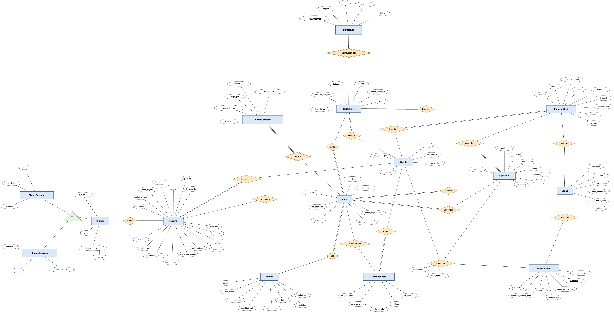

# SkyNest · Gestión de drones para envíos urbanos

**Proyecto Final de Base de Datos I (CS2041) · UTEC · ciclo 2026-2**
Grupo 3 · Tópico 4: *Gestión de Drones para Envíos Urbanos* · Profesor: Wilder Nina

| Integrante | Código |
|---|---|
| Saquiray Delgado, Samuel Aaron | 202310697 |
| Caceres Sanchez, Matias Andres | 202510370 |
| Del Negro Yabar, Giuseppe Antonio | 202110545 |

---

## 1. Resumen del proyecto

**SkyNest** es una empresa ficticia de reparto urbano con drones en Lima Metropolitana y el Callao. Este repositorio contiene su base de datos en **PostgreSQL 14**, desde el modelo hasta un **MVP web** que la usa.

Cada envío pasa por varias piezas, y la base registra todas:
- **Nests:** estaciones en azoteas donde los drones despegan, aterrizan y cargan.
- **Drones** de 8 modelos comerciales reales.
- **Baterías** intercambiables, con su telemetría.
- **Operadores** con licencia RPAS.
- **Rutas** aprobadas, con sus puntos de paso.
- **Permisos** para volar sobre distritos restringidos.
- **Clientes** (personas y empresas) y sus **paquetes**.

Para cada entrega se puede saber qué drone la hizo, con qué batería, por qué ruta, bajo qué operador y cómo se comportó la batería en vuelo.

| | |
|---|---|
| Tablas | 16 (11 entidades fuertes, 2 subclases, 2 débiles y 1 relación ternaria), normalizadas en FNBC |
| Reglas de negocio | 20 (R1–R20), implementadas con PK/FK/CHECK, un `EXCLUDE` y 17 triggers |
| Lógica en la base | 9 procedimientos almacenados, 9 vistas, 7 roles con privilegios mínimos |
| Datos | Reales (UBIGEO del INEI, fichas técnicas de drones, avenidas de Lima) y sintéticos coherentes |
| Escalas | 1 000, 10 000, 100 000 y 1 000 000 de vuelos (4 bases y 4 dumps) |
| Experimento | 5 consultas intermedias × 3 condiciones de índices × 4 escalas |
| MVP web | FastAPI + HTML/CSS/JS, conectado a PostgreSQL |

## 2. Lineamientos del curso

El proyecto se entrega en dos hitos (enunciado *Proyecto Final*, CS2041 2026-2):

**Hito 1 (entregado, 20/20):**
- Especificación de requisitos.
- Modelo entidad-relación con llaves, multiplicidad, participación, entidades débiles e IsA.
- Modelo relacional normalizado con sus restricciones de integridad.

Está en `docs/Proyecto_Hito1_Grupo3.pdf`.

**Hito 2 (este repositorio):**
- **Implementación en PostgreSQL:** creación de tablas, carga de datos reales y sintéticos, al menos 5 consultas intermedias no triviales, vistas, procedimientos almacenados y triggers para las reglas de negocio.
- **Optimización y experimentación:** las 5 consultas medidas con y sin índices en **4 escalas (1k, 10k, 100k y 1M)** con 4 dumps, el análisis de los tiempos de consulta y de actualización con distintos índices, y cuadros estadísticos.
- **Informe en LaTeX** con la estructura del enunciado (secciones 1 a 7) y **5 videos** del experimento con 1 millón de registros (uno por consulta), con y sin índices. Guía y scripts en `video_ejemplo/`.
- **Puntos extra (+2):** un MVP web funcional conectado a PostgreSQL que permita interactuar con los datos y ejecute las consultas intermedias.
- **Pregunta extra:** la complejidad por encima del millón de registros y si basta la arquitectura cliente-servidor.
- Penalidad de −4 puntos por día de retraso, con un máximo de 1 día.

## 3. Modelo de datos



| Tabla | Contenido |
|---|---|
| `distrito` | 50 distritos de Lima y Callao (UBIGEO); los restringidos requieren permiso |
| `estacion_nest` | 30 bases de despegue con capacidad y puertos de carga |
| `modelo_drone` | 8 modelos reales: DJI FlyCart 30/100, Wingcopter 198, Matternet M2/M3, Zipline P2, Wing Hummingbird, Manna |
| `drone`, `bateria` | 300 drones y 900 baterías (salud, ciclos, estado) |
| `operador`, `autorizacion` | Pilotos con licencia; autorización por terna (operador, modelo, distrito) |
| `cliente` ⊃ `cliente_persona`, `cliente_empresa` | Jerarquía IsA con cobertura y sin solapamiento |
| `ruta_vuelo`, `punto_ruta` | Corredores aprobados y sus *waypoints* (entidad débil) |
| `permiso_vuelo` | Permisos trimestrales para distritos restringidos |
| `vuelo` | Centro del modelo: drone + batería + ruta + operador (+ permiso) |
| `paquete` | Envíos con código de tracking, estado y fechas |
| `telemetria_bateria` | Lecturas de voltaje, corriente, temperatura y carga (entidad débil de `vuelo`) |

**Esquemas.** La base tiene dos esquemas (carpetas con nombre dentro de la base):
- `skynest`: el núcleo, con las 16 tablas, los triggers y los procedimientos.
- `reportes`: las 9 vistas y la función de rastreo `fn_rastrear_paquete`.

`sql/01_schema.sql` deja `search_path = skynest, reportes, public` como ruta por defecto de la base, así que en psql basta escribir `SELECT * FROM vuelo`. El analista solo tiene acceso a `reportes`: no puede ver las tablas del núcleo.

**Decisiones del Hito 2** (detalladas en el informe):
- **R5 se corrigió** porque contradecía a R9. Ahora se pueden crear rutas hacia distritos restringidos, pero cada vuelo necesita un permiso vigente.
- **La escala N es el número de vuelos**, con 1,5 paquetes y 5 lecturas de telemetría por vuelo. El Hito 1 preveía 180 lecturas por vuelo, que en la escala de 1M darían 180 millones de filas; se submuestreó.
- El generador usa una **semilla fija**: produce exactamente los mismos datos en cualquier computadora.

## 4. Estructura del repositorio

```
sql/
  01_schema.sql            16 tablas con PK, FK, UNIQUE, CHECK y EXCLUDE
  01_schema_prueba.sql     13 violaciones de restricciones que deben fallar
  02_datos_reales.sql      distritos, modelos de drone y nests reales
  03_triggers.sql          17 triggers: restricciones (i)–(x) y automatización de estados
  04_procedimientos.sql    9 procedimientos del flujo de un envío
  04_flujo_prueba.sql      flujo completo + 19 operaciones inválidas rechazadas
  05_vistas.sql            9 vistas de reportes + fn_rastrear_paquete
  06_roles.sql             7 roles (administrador, despachador, operador, cliente, técnico, analista, telemetría)
  06_roles_prueba.sql      cada rol puede lo suyo y nada más
  07_consultas.sql         las 5 consultas del experimento
  08_indices.sql           planes de índices A y B por consulta
gen/
  generar.py               generador de datos sintéticos coherentes + carga con COPY
  verificar.sql            18 verificaciones de reglas sobre los datos cargados
  construir_bases.sh       construye las 4 bases, las verifica y genera los dumps
bench/
  experimento.py           experimento automatizado: tiempos, planes, tablas LaTeX y gráficos
  resumir_planes.py        versión corta de los planes para el cuerpo del informe (la llama experimento.py)
web/
  app.py                   API y servidor de la web (FastAPI)
  db.py                    conexión a PostgreSQL
  laboratorio.py           ejecución de las consultas con cada plan de índices
  static/                  las 4 pantallas (HTML, CSS y JavaScript)
informe/
  informe_hito2.tex        informe completo (secciones 1 a 7)
  hito2_secciones.tex      secciones 4 a 7 del Hito 2
  resultados/              tablas, gráficos y planes que genera el experimento
docs/                      informe del Hito 1 y diagrama ER
presentacion/              diapositivas de la presentación del Hito 2 (PDF)
```

## 5. Stack tecnológico

| Capa | Tecnología |
|---|---|
| Base de datos | PostgreSQL 14 (extensión `btree_gist`) |
| Datos sintéticos | Python 3 + Faker + NumPy |
| Experimento | Python + psycopg2 + matplotlib |
| Web | FastAPI + Uvicorn (backend) · HTML, CSS y JavaScript sin frameworks (frontend) |
| Informe | LaTeX (Overleaf) |

**Dónde están los datos:** los 4 dumps (`dumps/skynest_1k.dump` … `skynest_1m.dump`, ~220 MB en total) están en el repositorio con **Git LFS**, porque el de 1M (~200 MB) supera el límite de 100 MB por archivo de GitHub. Las bases restauradas viven en el PostgreSQL de cada computadora. Como el generador usa una semilla fija, también se pueden reconstruir con un solo comando.

## 6. Cómo ejecutarlo

### Requisitos
- PostgreSQL 14 corriendo. En macOS: `brew install postgresql@14 && brew services start postgresql@14`.
- Python 3.11 o superior.

### Instalación
```bash
git clone https://github.com/gdny0208/Proyecto-Final-Skynest.git
cd Proyecto-Final-Skynest
python3 -m venv .venv
.venv/bin/pip install -r requirements.txt
cp .env.example .env            # edita usuario/puerto si no son los de tu PostgreSQL
```

### Construir las bases (una sola vez, ~5 minutos)
```bash
bash gen/construir_bases.sh        # skynest_1k, skynest_10k, skynest_100k y skynest_1m + dumps en dumps/
bash gen/construir_bases.sh 1k     # o solo una escala
```
Por cada escala crea la base, ejecuta `sql/01` y `02`, genera y carga los datos, instala `sql/03` a `06`, corre las 18 verificaciones (todas deben dar 0 violaciones) y guarda el dump.

Para restaurar un dump en lugar de generar la base, primero descarga los dumps (están en Git LFS; requiere `brew install git-lfs` una vez):
```bash
git lfs install && git lfs pull     # baja dumps/*.dump (~220 MB)
createdb skynest_1m && pg_restore -d skynest_1m dumps/skynest_1m.dump
psql -d skynest_1m -c "ALTER DATABASE skynest_1m SET search_path = skynest, reportes, public"
```
La segunda línea hace falta porque el dump guarda los esquemas, pero no la ruta de búsqueda por defecto.

### Levantar la web
```bash
.venv/bin/uvicorn web.app:app --reload
```
Abre **http://localhost:8000**. La documentación automática de la API está en http://localhost:8000/docs.

### Pruebas de la base (cada una deshace sus cambios al terminar)
```bash
psql -d skynest_1k -f sql/04_flujo_prueba.sql     # flujo de un envío + 19 violaciones rechazadas
psql -d skynest_1k -f sql/06_roles_prueba.sql     # permisos por rol
createdb skynest_vacia && psql -d skynest_vacia -f sql/01_schema.sql && psql -d skynest_vacia -f sql/01_schema_prueba.sql
```

### Experimento e informe
```bash
.venv/bin/python bench/experimento.py              # ~5 min; deja tablas, gráficos y planes en informe/resultados/
.venv/bin/python bench/experimento.py --solo-graficos
```
Luego se compila `informe/informe_hito2.tex`. En Overleaf, sube la carpeta `informe/` completa.

## 7. La web (MVP)

La web no tiene lógica de negocio propia: llama a las **vistas**, los **procedimientos almacenados** y las **5 consultas** de `sql/`, y la base valida todo con sus triggers. El selector de la barra superior cambia la base consultada (1k, 10k, 100k o 1M vuelos), así se puede ver en vivo el efecto de la escala.

| Pantalla | Qué muestra | Qué parte de la base usa |
|---|---|---|
| **Panel** (`/`) | Para el mes elegido: paquetes entregados, tasa de éxito, minutos promedio de entrega, vuelos por semana, distritos con más entregas, últimos vuelos, alertas de temperatura, licencias por vencer y el mapa de los 30 nests | Tablas `vuelo`, `paquete`, `telemetria_bateria`; vista `v_licencias_por_vencer` |
| **Rastrear** (`/rastrear`) | La vista del cliente: estado de un paquete por su código de tracking, su línea de tiempo y el vuelo que lo lleva | Función `fn_rastrear_paquete` (`SECURITY DEFINER`) |
| **Despacho** (`/despacho`) | El flujo de un envío: registrar paquete → programar vuelo (la base elige drone, batería, operador y permiso) → asignar → despegar → telemetría → aterrizar o cancelar, con los estados actualizados por los triggers. Tiene botones para provocar violaciones (sobrepeso R15, otro distrito R14, transición inválida) y ver el mensaje del trigger | `sp_registrar_paquete`, `sp_programar_vuelo`, `sp_asignar_paquete`, `sp_despegar_vuelo`, `sp_registrar_lectura`, `sp_cerrar_vuelo`, `sp_cancelar_vuelo` y los triggers de `sql/03` |
| **Laboratorio** (`/laboratorio`) | Las 5 consultas del experimento: se eligen sin índices, plan A o plan B (y opcionalmente `random_page_cost = 1.1`). Muestra el resultado, el tiempo (mediana de 3 corridas), los índices que usó el plan y el plan de ejecución completo. "Comparar" mide las tres condiciones y calcula cuántas veces más rápido es cada plan | `sql/07_consultas.sql` y `sql/08_indices.sql` (los mismos del informe) |

**API** (todas las rutas reciben `?base=skynest_xx`):

| Método | Ruta | Uso |
|---|---|---|
| GET | `/api/bases` | Bases disponibles y su número de vuelos |
| GET | `/api/panel?mes=AAAA-MM` | Indicadores del Panel |
| GET | `/api/rastrear/{codigo}` | Estado de un paquete |
| GET | `/api/distritos`, `/api/rutas?ubigeo=`, `/api/clientes?q=` | Datos para los formularios del Despacho |
| POST | `/api/paquetes` | Registrar paquete |
| POST | `/api/vuelos` | Programar vuelo |
| GET | `/api/vuelos/{id}` | Detalle del vuelo, sus paquetes, drone y batería |
| POST | `/api/vuelos/{id}/asignar` · `/despegar` · `/lectura` · `/cerrar` · `/cancelar` | Ciclo de vida del vuelo |
| GET | `/api/consultas` | Las 5 consultas y sus planes de índices |
| POST | `/api/consultas/{C1..C5}/ejecutar?condicion=sin\|A\|B&rpc=` | Ejecutar una consulta |
| POST | `/api/consultas/{C1..C5}/comparar` | Comparar las tres condiciones |

> El Laboratorio crea y borra índices en la base elegida para cambiar de condición. Es el comportamiento esperado: cada medición parte de un estado de índices conocido.

## 8. El experimento

| | Consulta | Plan A | Plan B |
|---|---|---|---|
| C1 | Tasa de entregas y minutos promedio por nest y distrito (un mes) | B+ en `vuelo.despegue` y `paquete.id_vuelo` | B+ cubrientes (`INCLUDE`) |
| C2 | Consumo de batería (pp/km) por modelo y ruta (un nest, un trimestre) | B+ compuesto `(id_ruta, despegue)` | B+ en fecha + cubriente de telemetría |
| C3 | Baterías sobre 60 °C en un mes, con sus vuelos y drones | B+ en `temperatura_c` | Índice **parcial** `WHERE temperatura_c > 60` |
| C4 | Vuelos y horas por drone vs promedio de su modelo (ventana) | B+ en `despegue` | BRIN en `despegue` |
| C5 | Paquetes express entregados con retraso, por distrito | B+ en `fecha_entrega` | B+ compuesto y cubriente |

Resultados en la escala de 1M (corrida oficial; detalle en el informe y en `informe/resultados/`):
- **C3:** el índice parcial la hace ~44 veces más rápida (127 → 2,9 ms) y ocupa 0,4 MB.
- **C1:** los índices cubrientes, ~4 veces.
- **C4:** el B+ en la fecha, ~2,9 veces (5 veces en 100k).
- **C2:** el B+ compuesto, ~2,2 veces (4 veces en 100k).
- **C5:** ~2,5 veces, y ~5,7 veces con `random_page_cost = 1.1`.
- **BRIN:** no sirve, porque los vuelos no están guardados físicamente en orden de fecha.
- **Costo de los índices:** todos juntos hacen ~1,8 veces más lentas las actualizaciones de paquetes y entre 1,8 y 2,7 veces la inserción de telemetría.

## 9. Problemas frecuentes

| Problema | Solución |
|---|---|
| `dropdb: database is being accessed by other users` | Cierra las conexiones a esa base en pgAdmin o VS Code y vuelve a correr `construir_bases.sh` |
| La web dice "No hay bases skynest_* con datos" | Corre `bash gen/construir_bases.sh 1k` y revisa los datos de `.env` |
| `connection refused` | Inicia PostgreSQL: `brew services start postgresql@14` |
| El Laboratorio tarda al cambiar de plan en la base de 1M | Es normal: está creando los índices de ese plan (1 a 4 s) |
